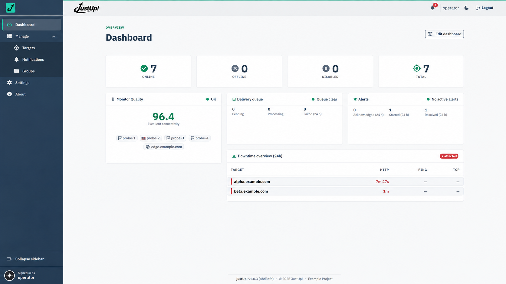
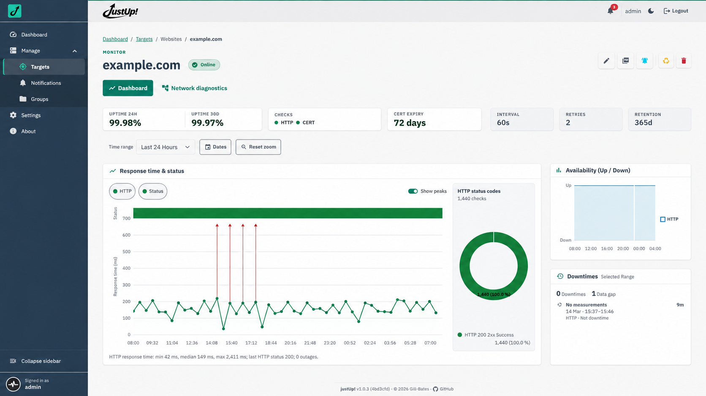
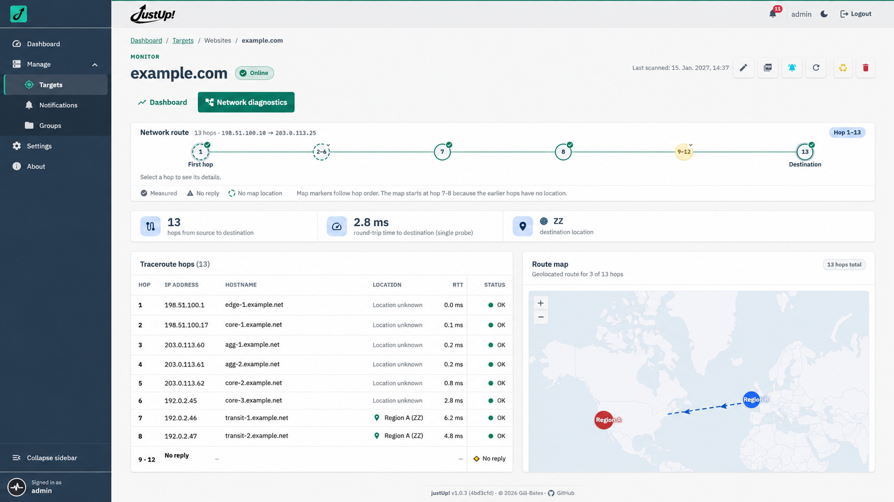
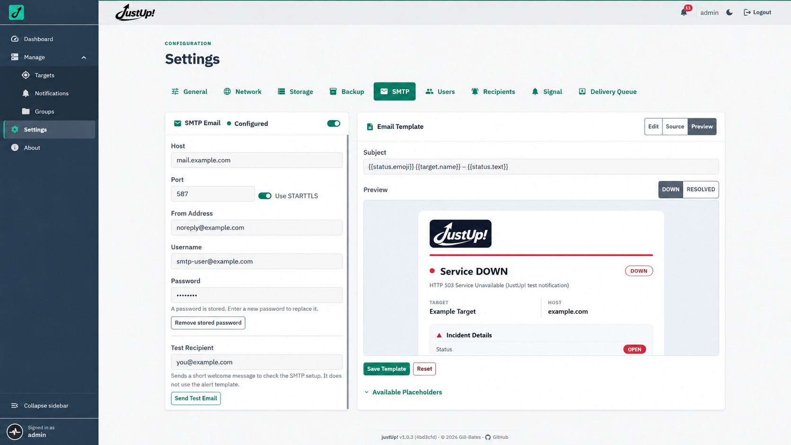

# justUp!

**Self-hosted uptime monitoring with network diagnostics built in.**
Fewer false alarms. Clearer diagnostics. Reports you can share. All in one container.

[](https://hub.docker.com/r/giiibates/justup)


justUp! brings availability monitoring, network diagnostics, and PDF reporting
together. Check hosts over ping, HTTP(S), TCP, and UDP, discover open ports with Nmap, and track certificate expiry.
When something goes wrong, inspect the network route and share the findings
without switching tools.

Application state and measurement history stay local. No agents to install on
monitored hosts, no separate Grafana instance, and no external database to maintain.

## Screenshots









## Why justUp!

| Why it matters | What you get |
| --- | --- |
| 🛡️ Fewer false alarms | The Quality Index checks justUp!'s own connectivity. When it falls below the configured minimum, due checks pause and affected targets show `unknown` rather than triggering misleading DOWN alerts. Checks resume when connectivity recovers. |
| 🧭 Diagnose beyond up or down | Run traceroute on demand, inspect hop details, and explore the route on a map without leaving the target view. |
| 📄 Reports ready to share | Generate print-ready PDFs per target with availability, SLA attainment, performance, TLS results, and network route details. |
| 📡 One container, no monitoring stack | Guided setup, checks, dashboard, and alerting together. SQLite and the built-in time-series database keep state and measurements local. |
| 📈 History beyond the latest check | Explore measurement charts and long-term rollups without running a separate metrics database. |
| 🔔 Alerts that keep trying | Receive email and Signal alerts, with queued delivery and retries when delivery fails. |

## Getting started

Requires Docker. Generate a secret key using the image, then start justUp!:

```bash
export SECRET_KEY="$(docker run --rm --entrypoint python giiibates/justup:latest -c 'from cryptography.fernet import Fernet; print(Fernet.generate_key().decode())')"
docker run -d \
  --name justup \
  --init \
  -p 127.0.0.1:8000:8000 \
  -e SECRET_KEY="$SECRET_KEY" \
  -v justup-data:/app/data \
  giiibates/justup:latest
```

Open <http://127.0.0.1:8000>, then get the initial `admin` password with
`docker logs justup`. The first sign-in requires a password change. Keep
`SECRET_KEY` safe and reuse it when recreating the container so stored secrets
remain readable.

See the [justUp! documentation](https://gill-bates.github.io/justup/) for
Compose, reverse proxies, configuration, backups, and operations.

[MIT License](https://github.com/Gill-Bates/justup/blob/main/LICENSE)

[](https://www.buymeacoffee.com/tnsteinerx)
