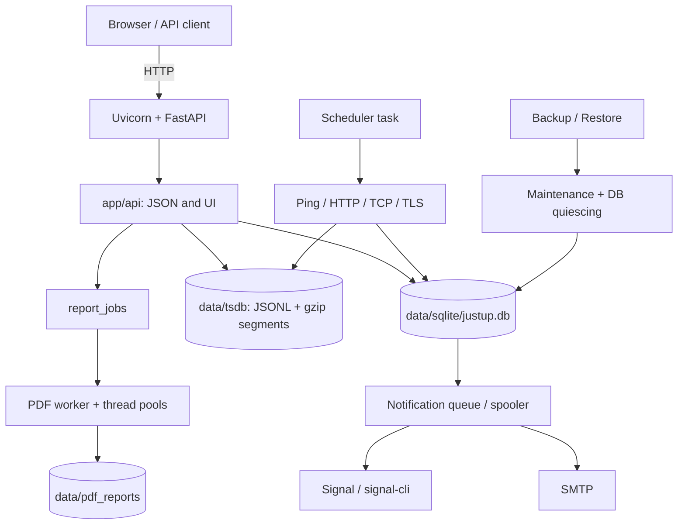

# Architecture

justUp! is a FastAPI application that runs in the container as **one Uvicorn
process**. Scheduler, rate limiter, maintenance mode, and background queues hold
process-local state. The image starts `python -m app`; additional workers or
multiple app processes on the same data directory are not supported.

## Overview

## Layers

- **Routes** live in `app/api/`. JSON resources and server-side UI pages
  are registered there together; `app/api/frontend.py` renders Jinja2 pages
  and fragments.
- **Persistence** lives in `app/db/`: `sqlite.py` manages configuration,
  users, targets, alerts, and jobs; `tsdb.py` stores measurement series as
  an active JSONL file per metric plus gzip segments for closed days, with rollups
  (`tsdb_segments.py` holds the segment naming and gzip I/O).
- **Monitoring** lives in `app/monitor/`: scheduler, checks, Quality Gate, and
  alert transitions.
- **Notifications** separate queue creation, dispatch, and delivery via
  SMTP or signal-cli.
- **Reports** are created as a job. A worker loop uses thread pools for
  measurement data, ReportLab, and matplotlib and stores the generated RGB PDF directly.
- **Backup and restore** live in `app/utils/backup.py` and `app/api/settings.py`.
  A process-wide maintenance mode stops new file work; restore then quiesces
  SQLite connections before data directories are swapped.

## Runtime model

- `app/__main__.py` starts exactly one Uvicorn process. `app/main.py` sets up the
  scheduler, the PDF worker, Signal, and the POP refresh in the lifespan and shuts
  them down again in a defined order.
- A central watchdog (`app/utils/supervisor.py`) supervises the scheduler (which also
  drives the notification spooler), the PDF worker, PDF cleanup, the POP refresh, and
  the release check.
  A crash, an unexpected return, or a scheduler without heartbeat for 30 minutes is
  restarted with exponential backoff (1 s to 60 s, +/-25 % jitter). Five crashes within
  5 minutes mark the service `degraded`: one ERROR log, then one retry every 5 minutes.
  Shutdown and maintenance are intended stops: nothing is restarted during either.
  The state of each service is part of the `/healthz` response (`services`, `degraded`);
  a degraded service does not fail the liveness probe.
- Blocking DB, file, network, and subprocess work runs in threads or
  thread pools. The PDF rendering runs within the PDF worker.
- Restore is a synchronously answered HTTP request with asynchronous
  file-I/O offloading; it is not a separate restore job. Maintenance mode waits
  up to 30 seconds for active work. On success, the DB and file work stay locked until
  the process restart; on a rollback, operation is released again.
- Browser state is refreshed via HTTP/HTMX fragments. An in-process event bus feeds
  `/ui/events` (Server-Sent Events), which carries invalidation hints only; clients
  reload through the REST endpoints and fall back to polling if the stream fails.

## Persistence

- The main database is at `data/sqlite/justup.db`; per connection,
  `busy_timeout`, foreign keys, and `synchronous=FULL` apply. WAL is enabled once at
  initialization and checked.
- `transaction(conn)` supports nested calls with savepoints; outer
  transactions can request `BEGIN IMMEDIATE`. `run_after_commit()` defers
  cache invalidations until the successful commit.
- The schema version is in `PRAGMA user_version`. New changes come as
  atomic, idempotent entries in `sqlite_db.MIGRATIONS`; data with a higher
  unknown version is rejected.
- Measurement data live in `data/tsdb`, grouped by target and metric: the current
  day in an uncompressed JSONL file, closed days in gzip segments. Daily housekeeping
  generates the 5-minute and 1-hour rollups and compresses closed days; see
  [Database maintenance](database-maintenance.md).
- Reports are stored under `data/pdf_reports`; Signal data is under
  `data/signal`; the GeoLite2 database is under `data/geoip`.

## Interfaces and tech stack

| Area | Implementation |
| --- | --- |
| Runtime | Python ≥ 3.13, Uvicorn, one app process |
| Web | FastAPI, Starlette, Pydantic, Jinja2 |
| API paths | resources live directly at `/targets`, `/settings`, etc.; POP admin under `/api/admin/pop` |
| Persistence | stdlib `sqlite3`, JSONL time series, no external database |
| Frontend | Bootstrap 5, HTMX fragments, and hand-written JavaScript without a build step |
| Fonts | locally embedded IBM Plex Sans (WOFF2 for browsers, TTF for PDFs) |
| Maps and charts | Leaflet and Chart.js, served locally; flag images are the documented CDN exception |
| PDF | ReportLab with embedded IBM Plex Sans and matplotlib charts at 600 dpi |
| Container | `docker/Dockerfile`, `docker/entrypoint.sh`, `docker/docker-compose.yml` |

Further functional requirements and historical decisions are in the
[specification](../spec/justup-spec.md); the current API contract is in
[API Overview](../api/overview.md) and the generated `/openapi.json`.
