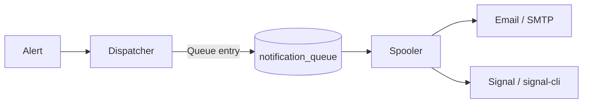

# Notifications

justUp! notifies via **email** and **Signal**. Delivery runs through a persistent
queue with retry and backoff – so no notification is lost.

## Recipients

A recipient has a name, a phone number (for Signal), and/or an email address
(at least one of the two), an active flag, and is assigned to targets. Only admins
may manage recipients with write access.

### Test messages

Admins can send a test message per recipient: the paper-plane button in the recipients list tests all
saved channels, and the Edit Recipient dialog tests Signal and email individually. The test uses the
**saved** channels, not unsaved field values (the dialog disables the buttons until the field matches
the saved value). A disabled recipient can be tested, so channels can be verified before enabling.
The message is marked as a test and goes through the spooler; the result per channel (sent or failed,
without internal error details) is shown in the dialog. A failed test is not retried.

## Dispatcher and spooler

Delivery is separated into two steps:

- The **dispatcher** creates queue entries only.
- The **spooler** sends – and only it. It processes the persistent queue:
  at most 5 attempts, backoff from 60 s to 1 h with jitter, a
  processing timeout, cleanup after 7 days.
- Signal is throttled (1 message, 2 s apart), email is sent in batches.

The spooler UI shows statistics and a log and allows flushing as well as clearing
the log.

## Email (SMTP)

=== "Connection"

    SMTP with STARTTLS or implicit TLS. Credentials are stored encrypted at
    rest (Fernet, see [Security](../security/overview.md)).

=== "Template"

    Subject and HTML template are editable, with a whitelist of allowed
    placeholders. A test email can be sent from the settings; it is queued
    like every other email and delivered by the spooler (with retry).

## Signal (signal-cli)

Signal runs through a local **signal-cli** in the container. Supported are:

- Registration via SMS or call (with captcha) and subsequent verification
- Linking as a secondary device via QR code as well as unlinking
- Profile name, editable DOWN/UP templates, and a test message

Memory and path can be controlled via `JAVA_XMS`, `JAVA_XMX`, and `SIGNAL_CLI_PATH`.
See [Environment Variables](../configuration/environment.md).

!!! note "Server-side only"
    Sending happens entirely on the server side via the spooler. There is no
    second, parallel delivery path.

## Notification Center (inbox)

The topbar bell and `Manage > Notifications` show a persistent inbox in the SQLite tables
`notifications` (one row per event, unique `idempotency_key`) and `notification_reads`
(`notification_id`, `user_id`, `read_at`; a missing row means unread). Deleting a notification in the UI (swipe left, hover or keyboard focus on the row, `POST /ui/notifications/{id}/dismiss`) stores a row in `notification_dismissals` and hides it for that user only; a new delivery in a grouped time window shows the group again. It is separate from the
`alerts` table and from `notification_queue` (SMTP/Signal delivery). Reading never acknowledges an
alert, and `open_total` stays the number of open monitoring alerts.

| Event | Audience |
| --- | --- |
| `monitoring.alert.opened`, `monitoring.alert.resolved`, `monitoring.certificate.warning` | admins and users assigned to the target |
| `report.completed`, `report.failed` | the requesting user only |
| `security.admin_password.changed`, `security.admin_password.reset`, `activity.user.created`, `activity.target.created` | admins |
| `activity.release.available` | admins |
| `delivery.email.sent`, `delivery.signal.sent` (grouped per channel and 10 minutes), `delivery.email.failed`, `delivery.signal.failed` | admins |

Once a day (random start delay, backoff on errors) justUp! asks the GitHub releases
API for the latest stable release and adds one `activity.release.available` notice
per newer version; notices at or below the installed version are retired. Nothing
else is sent, and there is no setting to turn the check off.

Successful sign-ins are not inbox events. Legacy `security.login.success` rows are hidden from the inbox without deleting the stored history.
An administrator's own password change and an admin password reset (including a
reset from `justup-cli`) create the corresponding admin-only inbox event.

Delivery events come from final spooler transitions only; retries are silent and no message
content or recipient address is stored. The browser polls `/ui/notifications/summary` every 15 s
(paused in hidden tabs) and refreshes at once on a live event. Schema version 2 added both tables and `report_jobs.user_id`; there is no
automatic deletion of notifications.
