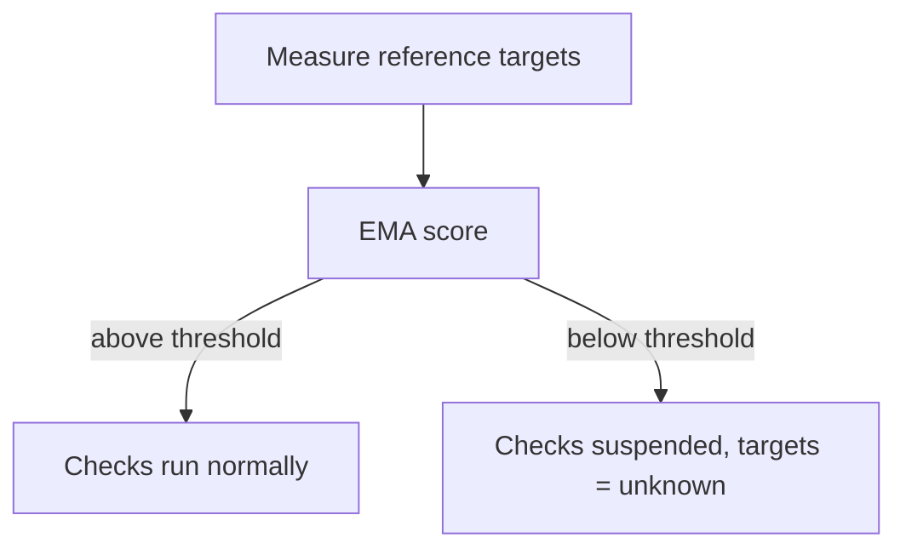

# Quality Gate

The Quality Gate protects against false alerts caused by network problems of the
justUp! instance itself. If its own connectivity is poor, justUp! suspends checks
instead of producing DOWN alerts across the board.

## How it works

- Every 30 s the instance probes its reference targets (five by default, at least
  three) and computes a smoothed score over a moving average (EMA).
- If the score falls below the threshold, due checks are suspended.
- Affected targets go to `unknown` – and `unknown` never alerts.
- As soon as the situation recovers, the checks continue normally.

## Visibility

The gate state is visible in the dashboard as a widget and available as a history.

## Configuration

Three settings under *Settings > Network* control the behavior
(changes take effect without a restart):

| Setting | Default | Purpose |
| --- | --- | --- |
| Probe Targets | `https://1.1.1.1`, `8.8.8.8`, `9.9.9.9`, `https://www.de-cix.net`, `https://cloudflare.com` | Editable chips in Settings (min. 3). An unchanged built-in list is stored as empty and **Reset to defaults** restores it. |
| Quality Minimum Score | 70 | threshold below which checks are suspended (0-100) |
| Quality RTT Threshold | 500 ms | RTT threshold for the evaluation (1-10000) |

See also [Settings](../configuration/settings.md).
